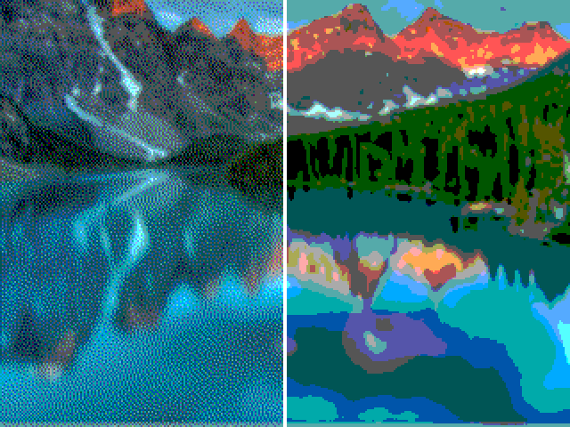

# Image transition

Compare the same photo in normal 6-bit RGB and Floyd-Steinberg dithered 6-bit RGB. The left side is dithered; the right side is normal. A white line marks the divider.



## Run in VGA Playground

Upload the CONTENTS of this folder to a new public GitHub repository. `info.yaml` must be at the repository root, beside `src` and `data`, not inside an extra folder. Use the `main` branch.

Replace ssrose-b in this link (and the repository name if different):

https://vga-playground.com/?repo=https://github.com/ssrose-b/Image-transition&ref=main

The playground reads `info.yaml`, loads the two Verilog source files, and fetches the `.mem` files referenced by `$readmemh` relative to `src`.

- Turn input 0 on to move left; turn it off to stop.
- Turn input 1 on to move right; turn it off to stop.
- Both off or both on: hold position.
- Reset returns to the center.
- `STEP_PIXELS` controls speed (default 4 pixels per frame).
- `FRAMES_PER_STEP` controls how many frames pass between movements (default 1).

## Change the photo

Install Python 3 and Pillow, then run from the repository root:

```sh
python3 -m pip install -r requirements.txt
python3 tools/image2hex.py /path/to/your-photo.jpg
```

The converter center-crops to 4:3, resizes to 320x240, and writes both `.mem` files and previews. Each file contains 76,800 hexadecimal RGB222 pixels in row-major order: bits 5:4 red, 3:2 green, 1:0 blue. No Verilog filename changes are required. Commit the regenerated `data` and `images` files to update the project.

The starter photo is a small crop from the mountain/lake picture in the supplied slide. The overlaid slide label is excluded, so the crop differs from the complete original photo. Use an original photo for better quality. The dithered version is generated anew, rather than copied from the slide's example.

## Verify locally

Install Icarus Verilog and run from the repository root:

```sh
cd src
iverilog -g2012 -s divider_tb -o /tmp/vga-divider-test project.v hvsync_generator.v ../tests/divider_tb.v
vvp /tmp/vga-divider-test
```

This checks memory loading, divider controls and limits, pixel selection, blanking, and VGA timing. Browser playback must also be checked after publishing.

This is a VGA Playground simulation project, not a chip-manufacturing submission or board-specific FPGA project.

## Credits

Based on the Tiny Tapeout VGA module interface and the image-loading example supplied by the user, credited to Uri Shaked / Tiny Tapeout LTD (2024), with image-loading modifications by Pongsgon Vichitvejpaisal. Their attribution is retained in the Verilog source. Code is provided under Apache-2.0. The supplied photo is reference material with its own rights; no ownership or separate license for it is claimed.
